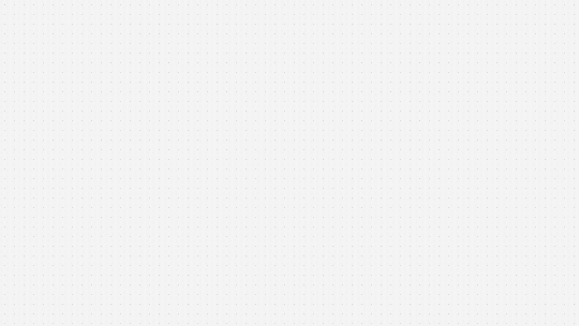

<div align="center">


# AAT, the Admin Annotation Tool

**Point at your app. Get a prompt your coding agent can act on.**

Pin a note on any element of your live app, or circle things with a red pen.
AAT turns each note into a ready prompt with the exact elements, selectors, React components,
current styles and a screenshot with your mark drawn in red.

[](./LICENSE)
[](https://docs.claude.com/en/docs/claude-code/skills)
[](https://nextjs.org/docs/app)
[](https://tailwindcss.com)

[Website and live playground](https://aat-tool.netlify.app/) · [Install](#install) · [How it works](#how-it-works) · [The prompt](#what-the-prompt-looks-like) · [Safety](#safe-by-design)

<br />



<sub>Silent 24 second demo. <a href="site/assets/aat-demo.mp4">Watch the MP4</a>.</sub>

</div>

---

## Why

Describing a UI change to an AI agent in words is slow and vague: "the button on the right, no, the other one". AAT lets you point at the live page instead. The agent gets the facts it needs to find the exact element in your codebase, and a picture of what you meant.

## How it works

1. **Pin or draw.** Open the tray on the right edge of the page. Click any element to pin a note, or draw over an area with the red pen. A closed loop takes everything inside it.
2. **Write what should change.** Type your comment and press Enter.
3. **Paste into your agent.** The prompt is already on your clipboard, with a screenshot of the spot and your mark drawn in red. Paste it into Claude Code, Cursor, Codex or any other coding agent.

## Features

| | |
|---|---|
| **Pin and pen** | Pin one element, or draw over many. The pen collects every element the stroke crosses; a closed loop also takes the elements inside it. |
| **Agent-ready prompts** | Page URL and title, viewport, and per element: tag and text, CSS selector, React component chain (in development), attributes, classes, size and position, current computed style. |
| **Marked screenshots** | Cropped around your mark with the mark drawn in red. On localhost it is saved into your project and the prompt points at the file. Elsewhere you copy it as an image. |
| **Pins that stay put** | Notes reappear on their element after a reload and follow it while you scroll and resize. |
| **Batch it** | A notes panel for this page or all pages. Copy one prompt, or every note as one prompt. |
| **Safe by design** | Admin only, never downloaded by visitors, never changes your page, notes stay in your browser. |

## What the prompt looks like

This is real output from AAT for one pinned button:

```text
[AAT note 1] Change request for my app

I pinned one element on the page and wrote a comment about it.

My comment: Make this button bigger and use our brand color

Page: http://localhost:3000/pricing ("Pricing")
Viewport: 1440x900
Screenshot of the marked spot, with my mark drawn in red: .data/aat/aat-m2x9k1-4f2a.png

Element: <button> "Start free trial"
  Selector: main > section:nth-of-type(2) > div > button
  React components (innermost first): Button < PricingCard < PricingPage
  Attributes: type="button"
  Classes: rounded-lg bg-zinc-900 px-4 py-2 text-sm text-white
  Size: 148x36px at x 812, y 640 (page)
  Current style: font: Inter 14px, weight 500, line-height 20px; color: #ffffff; background: #18181b; padding: 8px 16px; radius: 8px

Find these elements in the codebase (search for the visible text, the React component names and the classes), make the change my comment asks for, and keep everything else exactly as it is. If the comment is unclear, ask me before changing anything.
```

Pen notes list every marked element (up to 12, innermost only) and add a "Section that holds the marked elements" block with their shared parent.

## Install

### With Claude Code (recommended)

AAT ships as a [Claude Code skill](https://docs.claude.com/en/docs/claude-code/skills). Clone it into your skills folder:

```bash
git clone https://github.com/adigold/AAT-Tool.git ~/.claude/skills/admin-annotation-tool
```

Then, inside your project, ask Claude Code:

```text
Add AAT to this app
```

It follows [`SKILL.md`](./SKILL.md): installs the dependencies, copies the files, wires the admin gate and the screenshot route, and walks through the feature checklist.

### By hand

Requirements: **Next.js App Router**, **React 18+**, **Tailwind CSS v4**.

1. Install the dependencies:

   ```bash
   npm i modern-screenshot lucide-react sonner
   ```

   Make sure a sonner `<Toaster />` is mounted. The toasts carry the "Copy image" and "Copy" buttons.

2. Copy the files from [`references/`](./references):

   | From | To |
   |---|---|
   | `references/components/aat/*` | `src/components/aat/` |
   | `references/app/api/dev/aat-shot/route.ts` | `src/app/api/dev/aat-shot/route.ts` |

3. Set your app name in `src/components/aat/config.ts`.

4. Render the gate once near the root of your app, inside your providers:

   ```tsx
   import { AatGate } from "@/components/aat/gate";

   // Pass undefined (not false) while the user is still loading.
   <AatGate
     isAdmin={user ? user.role === "admin" : undefined}
     checkAdmin={async () => (await fetch("/api/me/is-admin")).ok}
   />
   ```

   `isAdmin` is used wherever your app already knows the user, with no extra request. `checkAdmin` is only called on pages where the user is not loaded, and only in a browser that has been an admin before, so visitors never trigger it.

5. Wire the screenshot route: replace `isAdmin()` in `route.ts` with your real admin check (it denies by default) and add `.data/` to your `.gitignore`.

6. Make sure Tailwind scans `src/components/aat/`.

The full step list, the design spec and the 15 point verification checklist are in [`SKILL.md`](./SKILL.md).

## Configuration

Everything you are meant to edit lives in [`config.ts`](./references/components/aat/config.ts):

| Key | Default | What it does |
|---|---|---|
| `appName` | `"my app"` | Shown in the first line of every prompt: "Change request for &lt;appName&gt;". |
| `storagePrefix` | `"aat"` | localStorage key prefix for the notes and the admin hint. |
| `shotEndpoint` | `"/api/dev/aat-shot"` | Where screenshots are saved on localhost. Set to `""` to skip saving files; the prompt then asks you to paste the image. |

## Keyboard

| Key | Action |
|---|---|
| `Enter` | Save the note and copy the prompt |
| `Shift` + `Enter` | New line in the comment |
| `Esc` | Step back one level: comment box, then mode, then panel |

## Safe by design

- **Admins only.** The tool is lazy loaded behind the gate, so visitors never download its code and public pages make no extra request.
- **Read only.** AAT reads the page and never changes it. It never selects, outlines or screenshots its own UI.
- **Contained.** Any error inside AAT is caught by an error boundary, logged as `[AAT] stopped:`, and the page keeps working.
- **Private.** Notes stay in your browser's localStorage (the last 200). Nothing is sent anywhere, except the screenshot to your own app on localhost.
- **A locked screenshot route.** It answers only on `localhost` or `127.0.0.1`, never on Netlify or Vercel, only for admins, only PNG files named `aat-[a-z0-9-]{4,60}.png`, at most 8 MB.

## Project layout

```text
SKILL.md                    The Claude Code skill: install steps, design spec, checklist
references/                 The source to copy into your app
  components/aat/
    aat.tsx                 Tray, pin picker, pen canvas, comment box, pins, notes panel
    aat.css                 Pop-in animation, scrollbar, pointer cursor
    config.ts               App name, storage prefix, screenshot endpoint
    describe.ts             DOM element to facts, and the prompt builder
    gate.tsx                Admin gate, lazy loading, error boundary
    shot.ts                 Screenshot of the marked spot with the red mark
  app/api/dev/aat-shot/
    route.ts                Localhost only route that saves screenshots
site/                       The landing page (plain HTML)
  aat-lite.js               Plain JS port of the widget, used by the live playground
  playground/               Demo admin dashboard the playground annotates
  assets/                   Logo, demo video, GIF and images
demo-video/                 The HyperFrames source of the demo video
```

## Contributing

Issues and pull requests are welcome. Read [CONTRIBUTING.md](./CONTRIBUTING.md) first. To report a security issue, follow [SECURITY.md](./SECURITY.md).

## License

[MIT](./LICENSE) © 2026 Adi Goldstein
